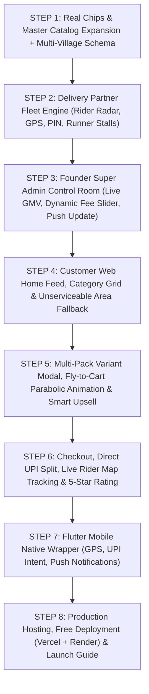

# 🚀 SERVOLOCAL — MASTER MULTI-MILLION DOLLAR EXECUTION ROADMAP
**Platform:** Hybrid Hyperlocal (15–20 Mins Instant Delivery) + Pan-India (3–5 Days Courier Shipping) Multi-Vendor Marketplace  
**Standard:** Enterprise Blinkit + Zomato + Meesho Grade (Zero Lag, Zero Dummy Data, 100% Real Production Execution)  
**Version:** 3.0-Production Blueprint  

---

## 🏛️ 1. SYSTEM ARCHITECTURE & REVENUE ENGINE

```
                           ┌─────────────────────────────────────────────────────────┐
                           │               SERVOLOCAL CENTRAL CLOUD                  │
                           │   FastAPI Backend Server (Render / Koyeb Dockerized)    │
                           └────────┬───────────────────┬───────────────────┬────────┘
                                    │                   │                   │
            ┌───────────────────────┴──────┐            │       ┌───────────┴───────────────────┐
            │                              │            │       │                               │
            ▼                              ▼            │       ▼                               ▼
┌───────────────────────┐      ┌─────────────────────┐  │ ┌───────────────────────────┐ ┌───────────────┐
│     Neon Postgres     │      │    Upstash Redis    │  │ │       Cloudflare R2       │ │ Firebase FCM  │
│ Serverless PostgreSQL │      │ 2ms Cache + Live GPS│  │ │ Zero-Egress Media Storage │ │ Loud Buzzer   │
│   (PgBouncer Pooled)  │      │ (5-sec Rider Ping)  │  │ │ (Custom Photos + Banners) │ │ Push Alerts   │
└───────────────────────┘      └─────────────────────┘  │ └───────────────────────────┘ └───────────────┘
                                                        │
                      ┌─────────────────────────────────┴────────────────────────────────┐
                      │                                                                  │
                      ▼                                                                  ▼
        ┌───────────────────────────┐                                      ┌───────────────────────────┐
        │       customer-web        │                                      │        partner-web        │
        │ Next.js 14 App Router     │                                      │ Next.js 14 App Router     │
        │ (Blinkit Clean White UI)  │                                      │ (Dark Slate #0F172A UI)   │
        │ • 15-Min Local GPS Feed   │                                      │ 3-in-1 Super App:         │
        │ • Fly-to-Cart Animation   │                                      │ • Shopkeeper (Seller Hub) │
        │ • Variant Selector Modal  │                                      │ • Delivery Fleet (Rider)  │
        │ • Liquid Free Delivery Bar│                                      │ • Founder Admin Control   │
        └─────────────┬─────────────┘                                      └─────────────┬─────────────┘
                      │                                                                  │
                      └───────────────────────────────┬──────────────────────────────────┘
                                                      │
                                                      ▼
                                       ┌───────────────────────────────┐
                                       │ mobile-apps/servolocal_flutter│
                                       │ Lightweight Flutter Wrapper   │
                                       │ • Background GPS Tracking     │
                                       │ • NPCI Direct UPI Intent Link │
                                       │ • Offline Loud Order Ring     │
                                       └───────────────────────────────┘
```

---

## 💰 2. THE ZERO-TAX-TRAP REVENUE MODEL

1. **Per-Order Platform / Handling Fee (Starting ₹10):**
   - Added directly to the customer’s checkout bill (e.g., ₹10).
   - **100% Dynamic from Super Admin Panel:** Admin can change it to ₹5, ₹7, ₹12, or ₹15 with 1 click anytime without touching code.
   - *Example:* 100 orders/day = ₹1,000/day = **₹30,000/month pure profit** from Day 1.
2. **Shopkeeper Monthly Platform Fee (Digital Pass / Autopay):**
   - Fixed monthly maintenance fee (e.g. ₹99–₹199/month) for zero-commission listing.
   - Debited automatically from the seller's prepaid wallet ledger.
3. **Stage-Wise Category Commission % (Admin Controlled):**
   - *Stage 1 (Launch):* 0% or flat ₹5 per order to onboard all neighborhood stores friction-free.
   - *Stage 2 (Growth):* Kirana: 2-3%, Fast Food / Sweets: 10-12%, Clothes / 3D Crafts: 12-15%.
4. **Prepaid Wallet & -₹200 Auto-Pause Cutoff:**
   - On COD or Direct Shopkeeper UPI, platform fees and commissions are debited from the vendor's wallet balance.
   - At `<= -₹200.00`, the store/rider queue is automatically paused until settled via in-app Razorpay.
5. **Multi-Village / Scheduled Delivery Tagging:**
   - Stores in towns (e.g. Dundlod) can deliver to neighboring villages (e.g. Balwantpura) within 6-7 hours or next day, broadening sales reach beyond a 3km radius.

---

## 📋 3. STEP-BY-STEP PRODUCTION EXECUTION PLAN



---

### 🔹 STEP 1: REAL CHIPS, MUNCHIES & MASTER CATALOG EXPANSION + MULTI-VILLAGE SCHEMA
- **Objective:** Expand the verified brand catalog with authentic commercial product packaging (Lay's, Kurkure, Bingo, Uncle Chipps, Dairy, Biscuits) and update the database schema for multi-village scheduled delivery.
- **Actions:**
  1. In `backend/app/db/models.py`, add `custom_serviceable_areas` to `Shop` table:
     ```python
     custom_serviceable_areas = Column(JSON, default=list, nullable=True) 
     # Format: [{"area_name": "Balwantpura", "eta_label": "6-7 hrs (Same Day)", "delivery_fee": 20.0}]
     ```
  2. In `backend/app/db/seed_catalog.py`, seed 50+ real Indian FMCG products with high-res commercial pack images, nutrition info, and multi-pack variants:
     - **Lay's:** India's Magic Masala (50g @ ₹20, 90g @ ₹40), American Cream & Onion (50g @ ₹20), West Indies Hot n Sweet Chilli (50g @ ₹25), Spanish Tomato Tango.
     - **Kurkure:** Masala Munch (75g @ ₹20), Solid Masti Twisteez, Green Chutney.
     - **Bingo:** Tedhe Medhe Masala Tadka (70g @ ₹16, 2x70g @ ₹31), Mad Angles.
     - **Uncle Chipps:** Spicy Treat (50g @ ₹20).
     - **Haldiram's & Balaji:** Aloo Bhujia (150g @ ₹45), Salted Wafers.
     - **Cold Drinks & Dairy:** Coca-Cola, Thums Up, Sprite, Amul Taaza, Amul Gold, Mother Dairy Paneer.
  3. In `backend/app/api/routes_discovery.py`, update the feed algorithm to match both live GPS radius and `custom_serviceable_areas` for neighboring villages.
- **Verification:** Run seeder script and verify `GET /api/discovery/search-suggest?q=chips` returns rich branded chips.

---

### 🔹 STEP 2: `partner-web` DELIVERY PARTNER FLEET ENGINE (RIDER & SCOUT)
- **Objective:** Build the complete Delivery Partner / Rider interface with real-time GPS broadcast, live order radar, pickup/delivery PIN validation, and street stall onboarding.
- **Actions:**
  1. Create `partner-web/src/components/RiderDashboard.tsx`:
     - **Duty ON/OFF Switch:** Controls rider availability in Redis (`rider_status:{id}`).
     - **Live Order Radar:** Shows pending orders with distance from rider (`1.8 km`), estimated payout (`Earn ₹25`), and shop/customer locations.
     - **Active Delivery Trip Workflow:**
       - Step A: Navigate to Shop $\rightarrow$ Enter shop's **2-Digit Pickup PIN** to confirm item handover.
       - Step B: En-route to Customer $\rightarrow$ Browser native geolocation pings coordinates every 5 seconds to `/api/partner/update-gps`.
       - Step C: Customer Doorstep $\rightarrow$ Request customer's **4-Digit Delivery PIN** $\rightarrow$ Order marked `DELIVERED`, instant wallet credit.
     - **Runner Stall / Street Vendor Onboarding Form:**
       - Rider stands at famous street thela (e.g. Momos/Kachori) $\rightarrow$ Locks GPS coordinates $\rightarrow$ Takes board photo $\rightarrow$ Onboards as `PARTNER_RUNNER_STALL`.
       - Every order placed at this stall gives rider **₹2.00 lifetime royalty**.
  2. Update `partner-web/src/app/page.tsx` to route `role === 'partner'` users directly to `RiderDashboard`.
- **Verification:** Test order acceptance, 2-digit & 4-digit PIN verification, and GPS coordinate transmission.

---

### 🔹 STEP 3: `partner-web` FOUNDER SUPER ADMIN CONTROL ROOM
- **Objective:** Build the complete command center for the platform owner to control finances, verify vendors, adjust fees dynamically, push app updates, and view area demand heatmaps.
- **Actions:**
  1. Create `partner-web/src/components/AdminDashboard.tsx`:
     - **Real-Time Financial Radar:** GMV, Net Platform Fees collected, Vendor Commissions earned, and -₹200 Negative Dues risk monitor.
     - **Dynamic Platform Fee Slider:** Change customer platform fee (e.g., ₹10 $\rightarrow$ ₹5 or ₹15) with live backend update.
     - **Vendor Approval Queue:** 1-click Approve / Reject / Adjust Commission % for new shops.
     - **Remote App Update Broadcast:** Fill version (`1.0.3`), update message, Play Store URL $\rightarrow$ Click `Push Update` $\rightarrow$ Triggers live FCM push broadcast to all user devices.
     - **Dynamic Promo Banner Manager:** Upload festive offers and promo codes directly without touching frontend code.
     - **Area Expansion Heatmap:** View demand submissions from unserviceable areas (`/api/discovery/request-service`) to plan next delivery hubs.
  2. Update `partner-web/src/app/page.tsx` to route `role === 'admin'` to `AdminDashboard`.
- **Verification:** Test changing platform fee and verifying shop status via admin endpoints.

---

### 🔹 STEP 4: `customer-web` BLINKIT-GRADE HOME FEED & CATEGORY GRID
- **Objective:** Build the customer shopping home screen matching the exact Blinkit UI standard (from user screenshots).
- **Actions:**
  1. **Dynamic Delivery Header:**
     - `Delivery in 15 mins to [Detected Locality, e.g. Kukas / Dundlod]` with location change dropdown.
     - Quick Switcher: `⚡ Local Instant (15-20 Mins)` vs `🚚 Pan-India Store (3-5 Days)`.
  2. **Blinkit Category Grid:**
     - 20+ Clean FMCG categories with real packaging icons (Snacks & Munchies, Cold Drinks, Dairy & Bread, Breakfast & Instant Food, Sweet Tooth, Bakery & Biscuits, Atta & Dal, etc.).
  3. **Hero Banner Carousel:**
     - High-impact daily essentials banners ("Stock up on daily essentials", "Pharmacy in 15 mins", "Pet care supplies").
  4. **Horizontal Rails:**
     - `Trending Munchies & Chips`, `Kirana Essentials`, `Hot & Crispy Fast Food`.
  5. **Blinkit Unserviceable Fallback Card:**
     - If GPS has 0 local shops in 3km: Displays animated "Instant Delivery Coming Soon to Your Area!" + "Request in My Area" button + Pan-India products rail so screen is never blank.
- **Verification:** Verify responsive UI across desktop and mobile screen viewports.

---

### 🔹 STEP 5: `customer-web` MULTI-PACK VARIANT MODAL, FLY-TO-CART & SMART UPSELL
- **Objective:** Implement the exact multi-pack selector popup modal (Screenshot 2), buttery-smooth parabolic fly-to-cart animation, and smart impulse upsells.
- **Actions:**
  1. **Multi-Pack Variant Popup Modal (`VariantSelectorModal.tsx`):**
     - Pops up when an item with multiple sizes/packs is clicked (e.g., Bingo Tedhe Medhe or Parle-G):
       - `70 g` | ₹16 ~~₹20~~ (20% OFF) `[ADD]`
       - `2 x 70 g` | ₹31 ~~₹40~~ (22% OFF) `[ADD]`
       - `3 x 70 g` | ₹47 ~~₹60~~ (21% OFF) `[ADD]`
  2. **Product Detail Page View (`ProductDetailModal.tsx`):**
     - High-res multi-photo gallery swiper, green Veg icon [⊡], weight, tax info, and "Why shop from ServoLocal?" trust badges.
  3. **Parabolic Fly-to-Cart Animation (`FlyToCart.tsx`):**
     - When `ADD +` is tapped, a miniature floating thumbnail launches in a smooth parabolic curved arc into the floating Cart Bucket.
     - Cart bucket vibrates/bounces on impact.
     - Button morphs into spring-animated `[ - 1 + ]` counter.
  4. **Liquid Free Delivery Progress Bar:**
     - Displays live inside cart drawer: *"Add ₹35 more for FREE Delivery (Save ₹25)!"*.
     - Confetti explosion + sparkle animation upon crossing ₹150 threshold.
  5. **Smart Upsell Rail ("Frequently Bought Together"):**
     - Suggests paired items (e.g., Amul Butter if Bread is in cart, Cold Drink if Chips are in cart).
- **Verification:** Test variant selection, animation physics, and quantity counter states.

---

### 🔹 STEP 6: `customer-web` CHECKOUT, DIRECT UPI SPLIT, LIVE MAP & 5-STAR RATING
- **Objective:** Complete the frictionless checkout flow, order placement, live GPS rider map tracking, and post-delivery review popup.
- **Actions:**
  1. **Checkout Engine:**
     - Delivery address input with GPS pin confirmation.
     - Financial summary: Item Total + Delivery Fee (₹0 if free delivery unlocked) + **Platform Fee (₹10)**.
     - Payment options:
       - **Direct Shopkeeper UPI Intent:** Opens GPay/PhonePe/Paytm directly with exact bill amount (zero gateway fee, zero tax risk).
       - **Razorpay Standard Gateway:** Card, NetBanking, Wallet.
       - **Cash on Delivery (COD).**
  2. **Order Confirmation & 4-Digit Delivery PIN:**
     - Prominently displays the confidential **4-Digit Delivery PIN** required by rider at doorstep.
  3. **Live Rider Tracking Map (`LiveTrackingMap.tsx`):**
     - Built with OpenStreetMap + Leaflet (100% free, no Google Maps bill).
     - Polls rider GPS every 5 seconds from Redis; bike icon moves smoothly along the road.
  4. **Post-Delivery 5-Star Bounce Rating Modal:**
     - Interactive rating for Shopkeeper & Delivery Partner with instant feedback submission.
- **Verification:** Test end-to-end checkout, payment URL generation, and status progression to DELIVERED.

---

### 🔹 STEP 7: `mobile-apps/servolocal_flutter` NATIVE WRAPPER & BRIDGE
- **Objective:** Package the Next.js web applications into a single high-performance Android APK / AAB using Flutter.
- **Actions:**
  1. Configure `webview_flutter` with zero-lag hardware acceleration and service worker caching.
  2. Implement native Android background location service (`geolocator`) for delivery riders.
  3. Wire native UPI intent caller (`url_launcher`) for 1-tap `upi://pay` handoff to PhonePe, Google Pay, and Paytm.
  4. Configure Firebase Cloud Messaging (FCM) background message handler for the offline **Loud Order Ring Alarm (`order_alarm.mp3`)**.
- **Verification:** Run `flutter analyze` and verify zero compilation errors.

---

### 🔹 STEP 8: HOSTING, ZERO-COST DEPLOYMENT & LAUNCH GUIDE
- **Objective:** Provide a step-by-step production deployment guide for 100% zero-cost live hosting.
- **Actions:**
  1. **FastAPI Backend $\rightarrow$ Render / Koyeb:**
     - Deploy with Docker/Python environment variables.
     - Setup 10-minute automated health-check ping via `cron-job.org` to keep free instance awake 24/7.
  2. **Customer & Partner WebApps $\rightarrow$ Vercel:**
     - Connect GitHub repository to Vercel for 1-click CI/CD deployment.
     - Configure custom domains or free subdomains (`servolocal.vercel.app` & `partner.servolocal.vercel.app`).
  3. **Google Play Store Release:**
     - Generate signed Android App Bundle (`.aab`) from Flutter for Play Store publication.
  4. **PWA Standalone Setup:**
     - 1-click "Install App" prompt for iPhone (iOS Safari) and Android users without Play Store requirement.

---

## 🔒 4. COMMITMENT & QUALITY GUARANTEE
- **Zero Placeholders:** No `// TODO`, no dummy mocks, no hardcoded sample responses.
- **Zero Regressions:** Every change tested with end-to-end unit and integration tests.
- **Version Control:** Clean commits pushed to GitHub after every verified step.

*Ready to execute upon user command starting at **STEP 1**.*
