# 🚀 SERVOLOCAL — ENTERPRISE MICRO-STEP EXECUTION ROADMAP
**Platform:** Hybrid Hyperlocal (15–20 Mins Instant Delivery) + Pan-India (3–5 Days Courier Shipping) Multi-Vendor Marketplace  
**Standard:** Enterprise Blinkit + Zomato + Meesho Grade (Zero Lag, Zero Dummy Data, 100% Real Production Execution)  
**Execution Strategy:** Fine-Grained Micro-Steps (One Focused Task at a Time, 100% Tested & Verified before moving forward)  

---

## 💰 1. ACCURATE REVENUE & FINANCIAL SPLIT MODEL

There are **3 distinct revenue channels** that ensure zero tax liability on gross sales turnover:

```
                            CUSTOMER BILL (Paid via UPI / COD)
                                        │
             ┌──────────────────────────┴──────────────────────────┐
             ▼                                                     ▼
     Items Total (₹200) + Delivery Fee (₹25)               Customer Handling Fee (₹3–₹5)
             │                                                     │
             ▼                                                     ▼
┌──────────────────────────────┐                         ┌───────────────────────┐
│       PARTNER REVENUE        │                         │  COMPANY DIRECT PROFIT│
│  • Shopkeeper gets: ₹180     │                         │  • Platform Handling  │
│    (₹200 - ₹20 commission)   │                         │    Fee (₹3–₹5)        │
│  • Delivery Boy gets: ₹19    │                         │  • Net margin from    │
│    (out of ₹25 delivery fee) │                         │    Partners (₹10)     │
│  • Scout Royalty: ₹2         │                         │                       │
└──────────────┬───────────────┘                         └───────────┬───────────┘
               │                                                     │
               ▼                                                     ▼
   Prepaid Wallet Ledger Debit                            TOTAL COMPANY NET EARNING
 (Auto-Pause Cutoff at -₹200)                                   (₹13 – ₹15 / order)
```

1. **Customer Handling Fee (₹3 to ₹5):**
   - Added directly to the customer’s checkout bill (e.g. ₹5, just like Blinkit / Swiggy Instamart).
   - Dynamic from Admin Panel: Can be set to ₹3, ₹5, ₹7 with 1 click.
2. **Partner Platform Fee & Commission Cut (Starting ₹10):**
   - The platform’s cut from the 2 partners on every completed order:
     - **Delivery Margin:** ₹4–₹6 deducted from the delivery fee.
     - **Shopkeeper Platform Cut:** Base platform fee / commission deducted from the shopkeeper.
   - **Dynamic Control:** Admin can adjust the default ₹10 platform cut from the Super Admin Panel.
3. **Monthly Shopkeeper Platform Fee / Digital Pass (Autopay):**
   - Nominal monthly maintenance fee (e.g. ₹99–₹149/month) for verified shop listing and zero-commission privileges.
   - Debited automatically from the shopkeeper's prepaid wallet balance.
4. **Prepaid Wallet & -₹200 Auto-Pause Cutoff:**
   - On direct UPI or COD, platform earnings deduct from the vendor's wallet balance.
   - If dues reach `<= -₹200.00`, orders are automatically paused until cleared via 1-tap Razorpay repayment.
5. **Multi-Village / Scheduled Delivery Routes:**
   - Shopkeepers in towns (e.g. Dundlod) can deliver to neighboring villages (e.g. Balwantpura) on a scheduled 6-7 hr or same-day evening route.

---

## 🗂️ 2. GRANULAR MICRO-STEP BREAKDOWN (PHASE-WISE)

Every step is small, self-contained, and completely tested before moving to the next.

```mermaid
flowchart TD
    subgraph PHASE_1 ["PHASE 1: Backend Foundation & Real Catalog"]
        M1["Step 1.1: Multi-Village DB Schema & Shop Model Update"]
        M2["Step 1.2: Real Chips & Munchies 50+ Product Catalog Expansion"]
        M3["Step 1.3: Multi-Pack Variants & Quantity Discount Pricing Engine"]
        M4["Step 1.4: Firebase Cloud Messaging Event Dispatcher & Message Payloads"]
        M5["Step 1.5: 5-Second Real-Time Rider GPS Redis & WebSocket Broadcaster"]
    end

    subgraph PHASE_2 ["PHASE 2: Partner Web (Rider & Admin Hub)"]
        M6["Step 2.1: Delivery Partner Duty Switch & Live Order Radar"]
        M7["Step 2.2: Rider 2-Digit Pickup PIN & 4-Digit Delivery PIN Verification"]
        M8["Step 2.3: Runner Stall Street Thela Onboarding with Live GPS & Photo"]
        M9["Step 2.4: Founder Admin Live Financials & Dynamic Fee Slider"]
        M10["Step 2.5: Admin Remote App Update Broadcast & Promo Banner Engine"]
    end

    subgraph PHASE_3 ["PHASE 3: Customer Web (Blinkit-Grade UI)"]
        M11["Step 3.1: GPS Header, Mode Switcher & Blinkit Category Icon Grid"]
        M12["Step 3.2: Unserviceable Area Fallback Card & Request Service Tool"]
        M13["Step 3.3: Blinkit Multi-Pack Variant Selector Modal"]
        M14["Step 3.4: Parabolic Fly-to-Cart Animation & Morphing Counter"]
        M15["Step 3.5: Liquid Free Delivery Progress Bar & Smart Upsells"]
        M16["Step 3.6: Checkout, Direct UPI Split & 4-Digit Delivery PIN"]
        M17["Step 3.7: OpenStreetMap + Leaflet Live Rider Tracking Map & 5-Star Reviews"]
    end

    subgraph PHASE_4 ["PHASE 4: Mobile App, Production Hosting & Launch"]
        M18["Step 4.1: Flutter Mobile Native Wrapper, Geolocation & Loud Buzzer Receiver"]
        M19["Step 4.2: Zero-Cost Backend Deployment on Render with Cron Keep-Alive"]
        M20["Step 4.3: Customer & Partner WebApps Deployment on Vercel"]
        M21["Step 4.4: Android APK / AAB Compilation & Google Play Store Setup"]
    end

    PHASE_1 --> PHASE_2 --> PHASE_3 --> PHASE_4
```



---

### 📦 PHASE 1: BACKEND FOUNDATION, CATALOG & REAL-TIME ENGINES

#### 🔹 Step 1.1: Multi-Village DB Schema & Shop Model Update
- **Files Modified:** `backend/app/db/models.py`, `backend/app/api/routes_seller.py`, `backend/app/api/routes_discovery.py`
- **What it does:**
  - Adds `custom_serviceable_areas = Column(JSON, default=list)` to `Shop` model.
  - Allows shopkeepers in Dundlod to add neighboring villages like `Balwantpura`, `Kolinda`, `Gothra` with custom delivery ETA (e.g. `6-7 hrs` / `Same Day Evening`) and custom delivery fee.
  - Updates Discovery Feed so customers in Balwantpura see Dundlod stores with scheduled badges!
- **Verification:** Database migration test + API test confirming shop appears in neighboring village search.

#### 🔹 Step 1.2: Real Chips, Munchies & FMCG 50+ Product Catalog Expansion
- **Files Modified:** `backend/app/db/seed_catalog.py`, `backend/app/db/models.py`
- **What it does:**
  - Seeds 50+ real Indian FMCG products with authentic commercial packaging photos (as seen on Blinkit):
    - **Lay's:** India's Magic Masala (Blue), American Cream & Onion (Green), West Indies Hot n Sweet Chilli (Orange), Spanish Tomato Tango (Red).
    - **Kurkure:** Masala Munch, Solid Masti Twisteez, Green Chutney.
    - **Bingo:** Tedhe Medhe Masala Tadka, Mad Angles Achaari Masti.
    - **Uncle Chipps:** Spicy Treat.
    - **Haldiram's & Balaji:** Aloo Bhujia, Khatta Meetha, Salted Wafers.
    - **Cold Drinks & Dairy:** Coca-Cola, Thums Up, Sprite, Amul Taaza Milk, Amul Gold, Mother Dairy Paneer.
  - Each product has verified pack weights, official MRP, search keywords, and paired categories.
- **Verification:** Run seeder and verify `GET /api/discovery/search-suggest?q=chips` returns all items.

#### 🔹 Step 1.3: Multi-Pack Variants & Quantity Discount Pricing Engine
- **Files Modified:** `backend/app/db/models.py`, `backend/app/api/routes_discovery.py`, `backend/app/api/routes_orders.py`
- **What it does:**
  - Supports pack variations (as shown in Blinkit Screenshot 2):
    - Example: *Bingo Tedhe Medhe*:
      - Single Pack: `70 g` @ ₹16 (MRP ₹20, 20% OFF)
      - Double Pack: `2 x 70 g` @ ₹31 (MRP ₹40, 22% OFF)
      - Family Pack: `3 x 70 g` @ ₹47 (MRP ₹60, 21% OFF)
  - Cart calculation automatically applies multi-pack savings.
- **Verification:** Test cart calculation endpoint with multi-pack quantity items.

#### 🔹 Step 1.4: Firebase Cloud Messaging Event Dispatcher & Message Payloads
- **Files Modified:** `backend/app/core/fcm_notify.py`, `backend/app/api/routes_orders.py`
- **What it does:**
  - Implements complete FCM notification payloads for each milestone:
    1. **Order Placed:** Sends high-priority push with `channel_id: "order_alarm"` and sound `order_alarm.mp3` to Shopkeeper:
       `"🔔 New Order #SL-9821 (₹230) - 3 Items! Tap to accept."`
    2. **Order Ping to Delivery Fleet:** Sends notification to online riders in that zone:
       `"⚡ New Delivery Job available in Kukas: Earn ₹25 (1.8 km)."`
    3. **Order Accepted & Out for Delivery:** Sends instant alert to Customer:
       `"🛵 Your order from Sharma Kirana is out for delivery! Share PIN: 8942 with rider."`
    4. **Low-Stock Alert:** Sends alert to vendor when stock `<= 5`.
- **Verification:** Test FCM notification builder with mock and live tokens.

#### 🔹 Step 1.5: 5-Second Real-Time Rider GPS Redis & WebSocket Broadcaster
- **Files Modified:** `backend/app/core/redis_cache.py`, `backend/app/main.py`, `backend/app/api/routes_partner.py`
- **What it does:**
  - When Rider broadcasts coordinates via `POST /api/partner/update-gps`, stores `{lat, lng, heading, timestamp}` in Upstash Redis (`order_gps:{order_id}`).
  - Provides WebSocket endpoint `/ws/order/{order_id}` and fallback REST polling `/api/orders/{order_id}/live-location` so customer map updates smoothly every 5 seconds.
- **Verification:** Send simulated GPS pings and verify instant retrieval from Redis.

---

### 🏍️ PHASE 2: PARTNER WEB (RIDER & FOUNDER ADMIN HUB)

#### 🔹 Step 2.1: Delivery Partner Duty Switch & Live Order Radar
- **Files Modified:** `partner-web/src/components/RiderDashboard.tsx`, `partner-web/src/app/page.tsx`
- **What it does:**
  - Duty ON/OFF glowing toggle switch (broadcasts online status).
  - Live Radar of incoming neighborhood deliveries showing pickup distance, dropoff address, and guaranteed earnings (`Earn ₹25 • 1.8 km`).
  - Audio alert chime on new order appearance.
- **Verification:** Test accepting orders from radar.

#### 🔹 Step 2.2: Rider 2-Digit Pickup PIN & 4-Digit Delivery PIN Verification
- **Files Modified:** `partner-web/src/components/RiderDashboard.tsx`
- **What it does:**
  - Shop pickup screen: Rider shows or enters the **2-Digit Pickup PIN** to verify item handover.
  - Customer doorstep screen: Rider requests the **4-Digit Delivery PIN** from the customer $\rightarrow$ verifies with backend $\rightarrow$ order transitions to `DELIVERED` $\rightarrow$ cash or wallet balance updates.
- **Verification:** Test complete PIN verification lifecycle.

#### 🔹 Step 2.3: Runner Stall / Street Thela Onboarding with Live GPS & Photo
- **Files Modified:** `partner-web/src/components/RiderDashboard.tsx`
- **What it does:**
  - Rider on-ground scouting tool: Rider stands at a famous street stall (kachori/momos) $\rightarrow$ auto-locks GPS $\rightarrow$ snaps stall photo $\rightarrow$ registers as `PARTNER_RUNNER_STALL`.
  - Displays Rider’s passive income dashboard: *"You onboarded 12 street stalls. 45 orders today = ₹90 lifetime royalty earned!"*
- **Verification:** Test stall submission and verification flow.

#### 🔹 Step 2.4: Founder Admin Live Financials & Dynamic Fee Slider
- **Files Modified:** `partner-web/src/components/AdminDashboard.tsx`, `partner-web/src/app/page.tsx`
- **What it does:**
  - Real-time command center: Total GMV, Customer Handling Fees earned, Partner platform fee cuts, Active order tracker.
  - **Dynamic Fee Slider:** Change customer handling fee (₹5 $\rightarrow$ ₹10) or partner platform cut with 1 click.
  - Vendor approval queue: Approve, reject, or adjust commission % for new stores.
  - Negative dues ledger & auto-locked account radar.
- **Verification:** Test updating platform fee and approving shops.

#### 🔹 Step 2.5: Admin Remote App Update Broadcast & Promo Banner Engine
- **Files Modified:** `partner-web/src/components/AdminDashboard.tsx`
- **What it does:**
  - **1-Click App Update Push:** Enter version (`1.0.3`), update text, Play Store URL $\rightarrow$ Click `Push Update` $\rightarrow$ Triggers live FCM notification to all phones and sets update popup modal.
  - **Dynamic Banner Manager:** Create festive banners and discount codes without touching code.
  - **Area Expansion Demand Viewer:** Heatmap of requests from unserviceable zones.
- **Verification:** Test publishing an app update and verifying `GET /api/app-config`.

---

### 🛍️ PHASE 3: CUSTOMER WEB (BLINKIT-GRADE EXPERIENCE)

#### 🔹 Step 3.1: GPS Header, Mode Switcher & Blinkit Category Icon Grid
- **Files Modified:** `customer-web/src/app/page.tsx`, `customer-web/src/components/Header.tsx`, `customer-web/src/components/CategoryGrid.tsx`
- **What it does:**
  - Dynamic Header: `Delivery in 15 mins to [Detected Locality, e.g. Kukas / Dundlod]` with GPS auto-detection.
  - Quick Switcher: `⚡ Local Instant (15 Mins)` vs `🚚 Pan-India Store (3-5 Days)`.
  - Floating Instant Search bar with rotating placeholder (`Search 'chips', 'paneer', 'milk'`).
  - 20+ FMCG Category Icons grid with authentic packaging graphics (Snacks, Dairy, Cold Drinks, Biscuits, Atta, etc.).
- **Verification:** Test responsive layout on mobile and desktop viewports.

#### 🔹 Step 3.2: Unserviceable Area Fallback Card & Request Service Tool
- **Files Modified:** `customer-web/src/components/UnserviceableFallback.tsx`
- **What it does:**
  - When user is in an unserved area (0 local shops within 3km):
    - Shows animated Blinkit-style *"Instant 15-min delivery coming soon to your area!"* card.
    - 1-Tap *"Request Delivery in My Area"* button (submits GPS, locality, phone to backend).
    - Displays Pan-India clothing, handicrafts, and non-perishable snack catalog below so user never sees a blank screen!
- **Verification:** Test with unserviceable coordinates (e.g. Delhi) and submit demand request.

#### 🔹 Step 3.3: Blinkit Multi-Pack Variant Selector Modal
- **Files Modified:** `customer-web/src/components/VariantSelectorModal.tsx`
- **What it does:**
  - When tapping a product with multiple sizes (e.g., Bingo Tedhe Medhe or Parle-G):
    - Opens clean rounded modal with individual pack options:
      - `70 g` | ₹16 ~~₹20~~ (20% OFF) `[ADD]`
      - `2 x 70 g` | ₹31 ~~₹40~~ (22% OFF) `[ADD]`
      - `3 x 70 g` | ₹47 ~~₹60~~ (21% OFF) `[ADD]`
  - Also displays Veg icon [⊡], detailed grammage, and "Why shop from ServoLocal?" trust badges.
- **Verification:** Test opening modal, selecting pack sizes, and adding to cart.

#### 🔹 Step 3.4: Parabolic Fly-to-Cart Animation & Morphing Counter
- **Files Modified:** `customer-web/src/components/FlyToCart.tsx`, `customer-web/src/components/ProductCard.tsx`
- **What it does:**
  - When `ADD +` is tapped, a miniature thumbnail launches in an authentic curved parabolic arc directly into the floating Cart Bucket.
  - Cart bucket bounces with spring physics on impact.
  - `ADD +` button morphs into a green `[ - 1 + ]` quantity counter.
- **Verification:** Test animation trajectory on different screen sizes.

#### 🔹 Step 3.5: Liquid Free Delivery Progress Bar & Smart Upsells
- **Files Modified:** `customer-web/src/components/CartDrawer.tsx`
- **What it does:**
  - Animated Liquid Progress Bar at top of cart: *"Add ₹35 more from Sharma Kirana for FREE Delivery (Save ₹25)!"*.
  - Crossing the ₹150 threshold triggers confetti explosion + green glow + *"Yay! You unlocked FREE Delivery!"*.
  - Smart Upsell Rail: *"Frequently Bought Together"* (e.g. Butter if Bread is in cart, Cold Drink if Chips are in cart).
- **Verification:** Test progress bar fills and upsell 1-click addition.

#### 🔹 Step 3.6: Checkout, Direct UPI Split & 4-Digit Delivery PIN
- **Files Modified:** `customer-web/src/components/CheckoutModal.tsx`, `customer-web/src/components/OrderConfirmed.tsx`
- **What it does:**
  - Financial breakdown: Items Total + Delivery Fee (₹0 if unlocked) + **Customer Handling Fee (₹5)**.
  - Payment choices:
    - **Direct Shopkeeper UPI Intent:** 1-tap open GPay/PhonePe with exact amount (zero gateway fee, zero tax risk).
    - **Razorpay Standard:** Card, NetBanking, UPI.
    - **Cash on Delivery (COD).**
  - Confirmed screen displays the **4-Digit Delivery PIN** required by rider at doorstep.
- **Verification:** Test order placement across all 3 payment methods.

#### 🔹 Step 3.7: OpenStreetMap + Leaflet Live Rider Tracking Map & 5-Star Reviews
- **Files Modified:** `customer-web/src/components/LiveTrackingMap.tsx`, `customer-web/src/components/ReviewModal.tsx`
- **What it does:**
  - 100% free live tracking: OpenStreetMap + Leaflet map with smooth moving bike icon (polling rider GPS from Redis every 5 seconds).
  - ETA counter (e.g. *"Arriving in 6 mins"*).
  - Upon delivery: Interactive 5-Star bounce rating popup for Shopkeeper & Delivery Partner.
- **Verification:** Test live map coordinate updates and review submission.

---

### 📱 PHASE 4: FLUTTER MOBILE APP, PRODUCTION HOSTING & LAUNCH

#### 🔹 Step 4.1: Flutter Mobile Native Wrapper, Geolocation & Loud Buzzer Receiver
- **Files Modified:** `mobile-apps/servolocal_flutter/lib/main.dart`, `mobile-apps/servolocal_flutter/android/`
- **What it does:**
  - Configures hardware-accelerated WebView connecting to deployed webapps.
  - Wires native Android background GPS (`geolocator`) for delivery riders.
  - Wires native UPI intent caller (`url_launcher`) for PhonePe, GPay, Paytm.
  - Configures background FCM push notification receiver to play the offline **Loud Order Ring Alarm (`order_alarm.mp3`)**.
- **Verification:** Run `flutter analyze` and test Android platform build.

#### 🔹 Step 4.2: Zero-Cost Backend Deployment on Render with Cron Keep-Alive
- **Files Modified:** `render.yaml`, `backend/Dockerfile`
- **What it does:**
  - Deploys FastAPI backend on Render.com free tier.
  - Configures free `cron-job.org` health ping every 10 minutes to prevent Render free instance sleep mode (24x7 instant response).
- **Verification:** Test live HTTPS endpoint `/api/health` from public internet.

#### 🔹 Step 4.3: Customer & Partner WebApps Deployment on Vercel
- **Files Modified:** `customer-web/vercel.json`, `partner-web/vercel.json`
- **What it does:**
  - Connects GitHub repository to Vercel for automated CI/CD.
  - Sets up domains/subdomains:
    - Customer App: `servolocal.vercel.app`
    - Partner & Admin App: `partner.servolocal.vercel.app`
  - Validates PWA manifest installation on Android and iOS Safari.
- **Verification:** Test PWA install prompt on mobile browser.

#### 🔹 Step 4.4: Android APK / AAB Compilation & Google Play Store Setup
- **Files Modified:** `mobile-apps/servolocal_flutter/android/app/build.gradle`
- **What it does:**
  - Generates release keystore and signed Android App Bundle (`.aab`) for Google Play Console.
  - Generates debug and release `.apk` for instant direct download.
- **Verification:** Verify `.apk` installation on real Android device.

---

## 🔒 3. ZERO-ERROR EXECUTION RULE
Whenever you give the command: **"Start Step X"** (e.g. `Start Step 1.1`):
1. I will write 100% complete, bug-free, production code for that exact step.
2. I will run end-to-end integration and compilation tests.
3. I will commit and push the clean code to GitHub (`https://github.com/Priyanshu0sharma/Servolocal.git`).
4. Only after your approval will we proceed to the next step.

*Ready to execute upon your command starting with **Step 1.1**.*
