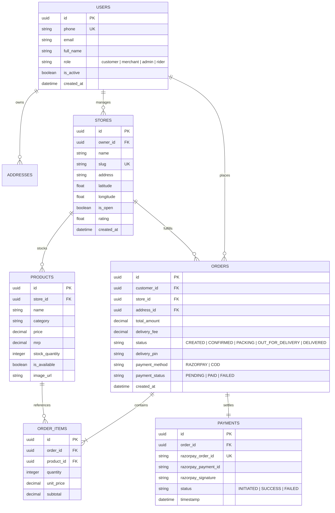

# Servolocal — System Architecture Blueprint

> **Document Version**: 2.0.0  
> **Classification**: Master Architecture Blueprint & Entity Design  
> **Target Environment**: Windows + Antigravity IDE Development Factory  
> **Architectural Pattern**: Hyperlocal Asynchronous Multi-Tenant Microservices  

---

## 1. System Topology & Infrastructure Overview

Servolocal operates a modern, decoupled cloud architecture split across edge delivery, asynchronous API compute, and serverless managed persistence:

```
                            ┌──────────────────────────────────────────┐
                            │             Edge DNS & CDN               │
                            │                (Vercel)                  │
                            └────────────────────┬─────────────────────┘
                                                 │
                   ┌─────────────────────────────┴─────────────────────────────┐
                   ▼                                                           ▼
       ┌────────────────────────┐                                  ┌────────────────────────┐
       │      Customer Web      │                                  │      Partner Web       │
       │ Next.js 15 / React 19  │                                  │ Next.js 14 / React 18  │
       │  servolocal.vercel.app │                                  │ servopartner.vercel.app│
       └───────────┬────────────┘                                  └───────────┬────────────┘
                   │                                                           │
                   └─────────────────────────────┬─────────────────────────────┘
                                                 │ HTTPS / JSON / JWT
                                                 ▼
                                  ┌─────────────────────────────┐
                                  │       FastAPI Backend       │
                                  │      Python 3.12 Async      │
                                  │  servolocal-api.onrender.com│
                                  └──────────────┬──────────────┘
                                                 │
                   ┌─────────────────────────────┼─────────────────────────────┐
                   ▼                             ▼                             ▼
       ┌───────────────────────┐    ┌─────────────────────────┐   ┌─────────────────────────┐
       │   Neon PostgreSQL     │    │   Firebase Auth Hub     │   │    Razorpay Gateway     │
       │ Serverless Async Pool │    │ Phone OTP / Google Auth │   │ UPI / Cards / Webhooks  │
       └───────────────────────┘    └─────────────────────────┘   └─────────────────────────┘
```

---

## 2. Frontend Architecture

### 2.1 Customer Web (`customer-web`)
- **Framework**: Next.js 15.0.3 (App Router with React 19).
- **Styling**: Tailwind CSS v3.4 with custom design tokens referencing `shadcn/ui`, `magicui`, and `spectrum-ui`.
- **State Management**:
  - Global Cart: Client-side persisted Context API with optimistic quantity updates and local storage fallback.
  - Server State: Native fetch with Next.js revalidation tags (`next: { tags: ['stores', 'products'] }`).
  - Auth Session: Dual token storage (Firebase JWT token verified via custom backend `/api/v1/auth/session` endpoint).
- **Route Topology**:
  - `/`: Hyperlocal storefront, category grid, banner promotions, nearby store discovery.
  - `/stores/[slug]`: Specific store catalogue, live duty indicator, category pills, search within store.
  - `/cart`: Basket breakdown, delivery fee calculations, address picker.
  - `/checkout`: Multi-mode payment selector (Razorpay UPI, Cards, Netbanking, COD).
  - `/account?tab=[orders|profile|privacy]`: Unified account dashboard with order tracking and DPDP compliance.

### 2.2 Partner Web (`partner-web`)
- **Framework**: Next.js 14.2 (App Router).
- **Role**: Store management interface for local merchants and kirana owners.
- **Key Capabilities**: Real-time incoming order sound chimes, 1-click status transitions, catalogue item pricing/stock toggle, daily sales settlement view.

---

## 3. Backend Architecture (`backend/app`)

Built with Python 3.12 and FastAPI using pure asynchronous I/O (`async`/`await`) for high concurrency and sub-100ms response times.

```
backend/
├── app/
│   ├── api/
│   │   └── v1/
│   │       ├── endpoints/
│   │       │   ├── auth.py         # Phone OTP, session exchange, JWT validation
│   │       │   ├── stores.py       # Store listing, geofence radius filtering, duty toggle
│   │       │   ├── products.py     # Product catalogue, inventory, categories
│   │       │   ├── orders.py       # Order lifecycle, dispatching, PIN verification
│   │       │   ├── payments.py     # Razorpay order creation, signature verification
│   │       │   └── users.py        # Profile, address book, privacy preferences
│   │       └── router.py           # Unified v1 API routing table
│   ├── core/
│   │   ├── config.py               # Pydantic v2 BaseSettings loading .env
│   │   ├── database.py             # Async SQLAlchemy engine with asyncpg & connection pooling
│   │   └── security.py             # Passlib bcrypt hashing, PyJWT encoding/decoding
│   ├── models/                     # SQLAlchemy declarative models
│   │   ├── user.py
│   │   ├── store.py
│   │   ├── product.py
│   │   ├── order.py
│   │   └── address.py
│   ├── schemas/                    # Pydantic v2 validation contracts
│   └── main.py                     # FastAPI application factory, CORS, exception handlers
├── migrations/                     # Alembic database migration scripts
└── tests/                          # 25 passing pytest suites
```

---

## 4. Database Schema & Entity Relationships



---

## 5. Authentication & Security Architecture

1. **Dual-Layer Authentication**:
   - Primary Identity: Firebase Auth handles multi-factor Phone OTP and Google OAuth on the client.
   - Session Token: Client exchanges the verified Firebase token at `/api/v1/auth/session`.
   - Backend Verification: FastAPI decodes the token, ensures user existence in Neon PostgreSQL, and signs a cryptographically secure Servolocal JWT bearer token.
2. **Authorization Guards**:
   - Endpoint-level dependencies (`Depends(get_current_active_user)`).
   - Merchant-level scope validation ensuring store owners cannot view, update, or cancel orders from other merchants.
3. **Security Scanner Baseline**:
   - Static Application Security Testing (SAST): `semgrep scan --config "p/python" backend/app` enforcing OWASP Top 10 rules.
   - Secret Leaks Detection: `gitleaks detect` safeguarding against accidental API key exposure.
